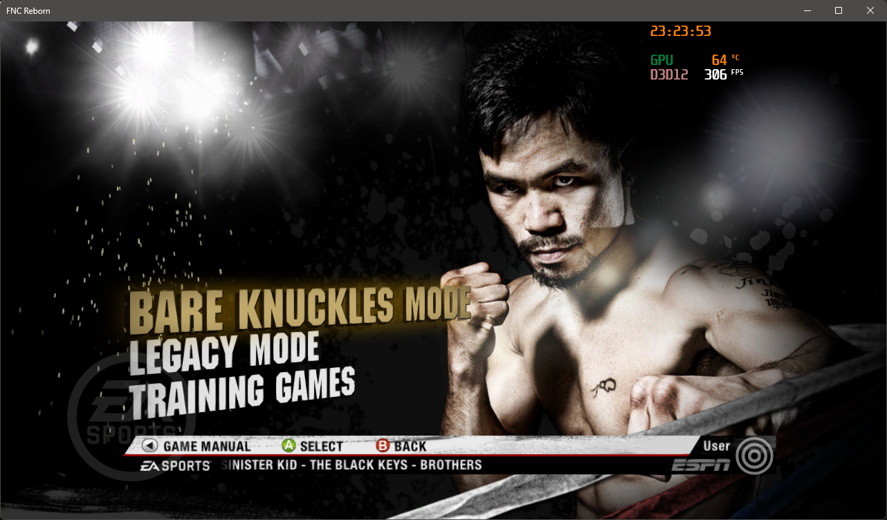
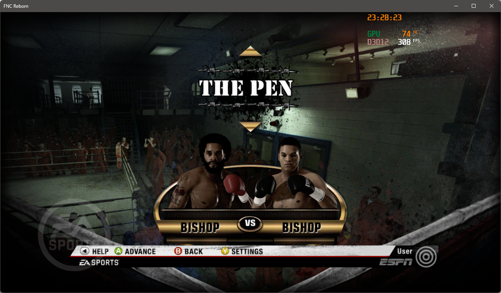
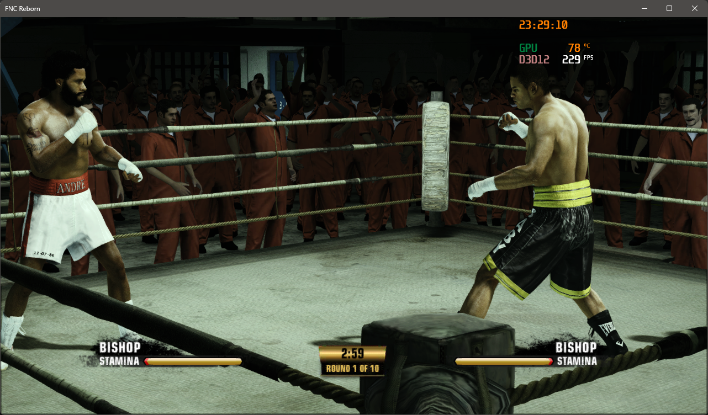
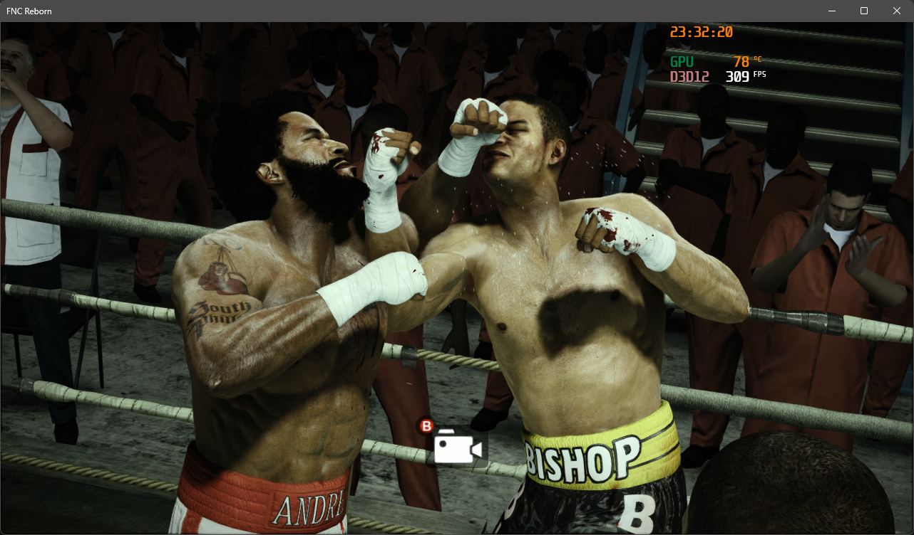
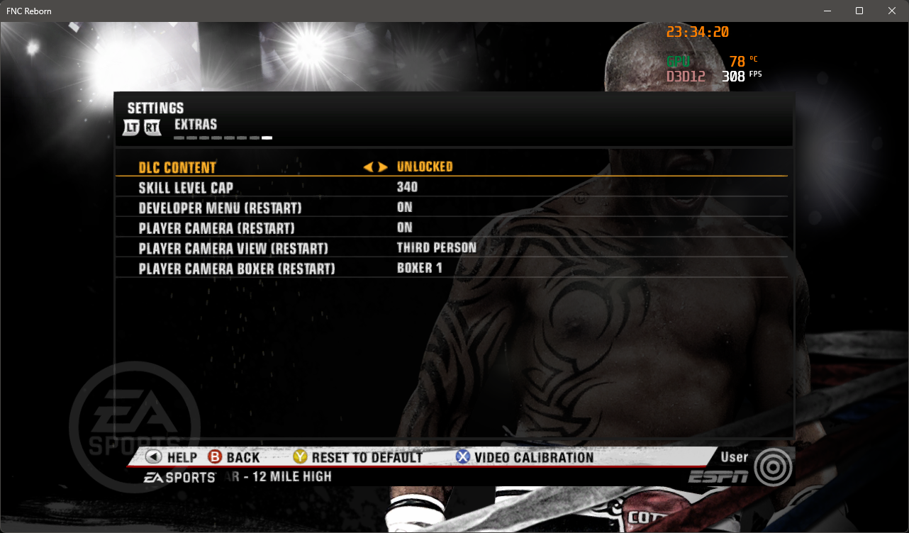

# FNC Reborn – TU2 + DLC

A fork of [**FNC Reborn by Whompay**](https://github.com/whompay/FNCReborn), the
unofficial native Windows port of **Fight Night Champion** (Xbox 360, 2011).

This fork builds the game with **title update 2** and makes **all of its DLC
work offline**:

- **Fight Night Legends Pack**: the Legends boxers, the two Legends venues and
  **Bare Knuckles Mode**.
- All **Champion Mode boxers**, the single-boxer packs and the **George
  Foreman** pre-order bonus.
- Every other licensed item, such as the **Everlast 100th Anniversary gear**.
- **Athleticism boosts** (Strength, Speed, Endurance, Conditioning,
  Toughness, Reflex; Bronze, Silver and Gold).
- **XP packs** (1,000 to 25,000 XP), always in stock.
- The Legacy Mode **skill level cap** raised from 220 ("…reached his skill
  level cap! For now…") up to 340.
- A new **EXTRAS** tab in the Settings screen to switch these on and off.
- **Instant replays** (knockdown replays and round highlights) work: the game
  gets the `cache:` drive it keeps its replay data on.

  
  

Everything from FNC Reborn is kept: 60 FPS and higher, the DISPLAY settings
tab and the camera behind your boxer.

**This repository contains no game code or data.** You build the game yourself,
on your own PC, from your own disc, your own title update and your own DLC.

> FNC Reborn is a fan project. It is not affiliated with, endorsed by or
> sponsored by Electronic Arts, EA Sports or Microsoft.

## What you need

- Your own Fight Night Champion (Xbox 360) disc, dumped to an `.iso` file.
- Your own **title update 2** package for the game: a file named
  `TU_12K228L_000000C000000.00000000000G3`, or the `default.xexp` from it (for
  example from Xenia's `content\0000000000000000\45410915\000B0000` folder).
  Title update 1 is not supported.
- Optional: your own **DLC**, as Xbox 360 packages (the 42-character files from
  `Content\0000000000000000\45410915\00000002` on a console) or as a folder
  Xenia installed them to. The **Legends Pack** is the one most of the content
  comes from.
- The title update and DLC can stay in the `.zip` files they came in; `.rar`
  and `.7z` work too when [7-Zip](https://www.7-zip.org) is installed. Put all
  your DLC in one folder (subfolders are fine) and select that folder.
- Windows 10 or 11 (64-bit) and a GPU with Direct3D 12 support.
- [Visual Studio 2022](https://visualstudio.microsoft.com/downloads/)
  (Community or Build Tools, both free) with the **Desktop development with
  C++** workload and these individual components:
  - C++ Clang Compiler for Windows
  - C++ CMake tools for Windows
- [Git for Windows](https://git-scm.com/download/win).
- [Python 3](https://www.python.org/downloads/), for the DISPLAY and EXTRAS
  tabs in the Settings screen. Without it the game works the same; the settings
  are then only in `dist\FNCReborn.toml`.
- About 25 GB of free disk space and 16 GB of RAM. The first build takes
  30–90 minutes depending on your CPU.

## Building

1. Download this repository to a short path, for example `C:\FNCRebornTU2`.
2. Run `setup.bat`.
3. Select your `.iso`, then your title update 2, then the folder with your DLC
   when asked (cancel the DLC dialog to skip it).

When it finishes, the game is in the `dist` folder. If a step fails, fix the
cause and run `setup.bat` again; finished steps are skipped. To add DLC later,
run `setup.bat -Dlc "D:\path\to\your\dlc"`. See
[docs/BUILDING.md](docs/BUILDING.md) for what each step does.

The one-click installer of the original project (`installer`,
`FNCReborn-Setup.exe`) has not been updated for this fork; use `setup.bat`.

## Playing

Run `dist\FNCReborn.exe`. An Xbox controller works as on the console.

| Key / button | Effect |
|---|---|
| Back (View on newer controllers) or F2 | Switch between the TV camera and a camera behind your boxer |
| F11 | Fullscreen / window |
| F1 | Frame rate counter |

Saves and DLC are stored in `Documents\FNCReborn-TU2`, apart from the original
FNC Reborn's `Documents\FNCReborn`. The first time, setup copies your existing
FNC Reborn saves there.

Knockdown replays and round highlights play as on the console. The game keeps
their data on its `cache:` drive, `Documents\FNCReborn-TU2\cache_drive`.

On entering Legacy Mode the game tries to log in to EA to sync XP and shows
*"You are not connected to EA Servers…"*. Press **OK**: it is only a warning.
The Fight Night Store screen and online modes do not work.

### Settings

Most settings are in the game's Settings screen under **DISPLAY** and
**EXTRAS**. Everything is also in `dist\FNCReborn.toml` (setup creates it once
and never overwrites it). The useful ones:

| Setting | Effect |
|---|---|
| `fnc_dlc_unlock` | All DLC unlocked (`true`, default) or as on a console without EA's servers (`false`) |
| `fnc_skill_level_cap` | Legacy Mode skill level cap: `220` (original) to `340`; default `320` |
| `fnc_debug_menu` | The developer menu (restart after changing) |
| `fnc_cache_drive` | The game's `cache:` drive, needed for replays (`true`, default); kept in `Documents\FNCReborn-TU2\cache_drive` |
| `fnc_frame_rate` | Frame rate cap: `30` (original), `60` (default), `120` or `144` |
| `vsync` | `true` or `false` |
| `resolution_scale` | Internal resolution: `1` (720p) or `2` (1440p) |
| `fullscreen` | Start in fullscreen (`true`) or a window (`false`) |
| `texture_cache_memory_limit_soft` / `_hard` | Texture memory in MB. Lower to `1024` / `2048` on a GPU with 4 GB or less |
| `fnc_tp_back`, `fnc_tp_height`, `fnc_tp_side`, `fnc_tp_fov` | Position and zoom of the camera behind your boxer |
| `fnc_tp_smooth` | How smoothly that camera follows (`0` rigid to `0.95` very floaty) |
| `fnc_view_boxer` | Set to `1` if that camera follows your opponent instead of you |
| `fnc_view_first_person` | `true` turns that camera into a first-person view |

## How it works

The ReXGlue SDK translates every PowerPC function in the game's executable to
C++ and reimplements the Xbox 360 kernel, GPU (on Direct3D 12), audio and
input. FNC Reborn adds the Fight Night Champion-specific parts; this fork
changes and adds:

| Path | Contents |
|---|---|
| `config/fnc_manifest.toml` | Recompiler configuration for the **title update 2** executable |
| `project/src/fnc_dlc_unlock.cpp` | Answers the game's DLC checks: boxers, venues, Bare Knuckles, boosts, XP packs |
| `project/src/fnc_skill_cap.cpp` | The Legacy Mode skill level cap |
| `project/src/fnc_settings_menu.cpp` | Values for the DISPLAY and EXTRAS tabs |
| `project/src/fnc_hooks.cpp`, `player_camera.cpp` | FNC Reborn's hooks, moved to their TU2 addresses; developer menu; the `cache:` drive |
| `project/src/fnc_app.h` | Saves in `Documents\FNCReborn-TU2` |
| `tools/fnc_content` | Reads your title update and DLC packages (with the SDK's own package reader) |
| `tools/display_tab` | Adds the DISPLAY and EXTRAS tabs to your copy of the Settings screen |
| `scripts/setup.ps1` | The build script behind `setup.bat` |

[docs/TU2_AND_DLC.md](docs/TU2_AND_DLC.md) explains the title update port and
each DLC fix; [docs/HOW_IT_WORKS.md](docs/HOW_IT_WORKS.md) covers FNC Reborn
itself.

## Legal

This project distributes only original source code, configuration files and a
patch to the BSD-licensed ReXGlue SDK. It does not include, and must not be
used to distribute, any part of Fight Night Champion: no disc images, title
updates, DLC, game files, recompiled code or built executables. Use your own.
Requests for or links to game files will be removed.

The code is released under the [Apache License 2.0](LICENSE). This is a
modified version of **FNC Reborn by Whompay**; see [NOTICE](NOTICE). If you
share, re-upload or build on it, keep the NOTICE file and credit FNC Reborn by
Whompay. The SDK and the libraries it downloads during the build are covered by
their own licenses; see [THIRD_PARTY_NOTICES.md](THIRD_PARTY_NOTICES.md).
"Fight Night" and "Fight Night Champion" are trademarks of their owner and are
used here only to name the game this project works with.

## Credits

- **FNC Reborn by Whompay**: the project this fork is based on.
- [ReXGlue SDK](https://github.com/rexglue/rexglue-sdk) by Tom Clay and
  contributors.
- [Xenia](https://xenia.jp) by Ben Vanik and contributors, which the SDK is
  derived from.
- illusion, for the Fight Night Champion "Unlock FPS" patch, and Adrian, for
  the TU2 "Debug Menu" patch, in
  [xenia-canary/game-patches](https://github.com/xenia-canary/game-patches).
- EA Canada, for the game.
